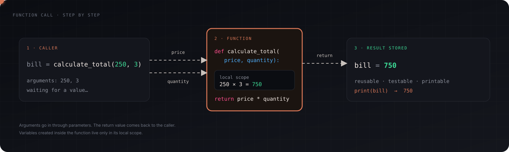
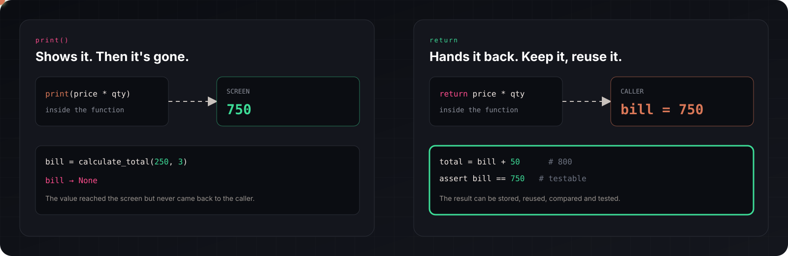
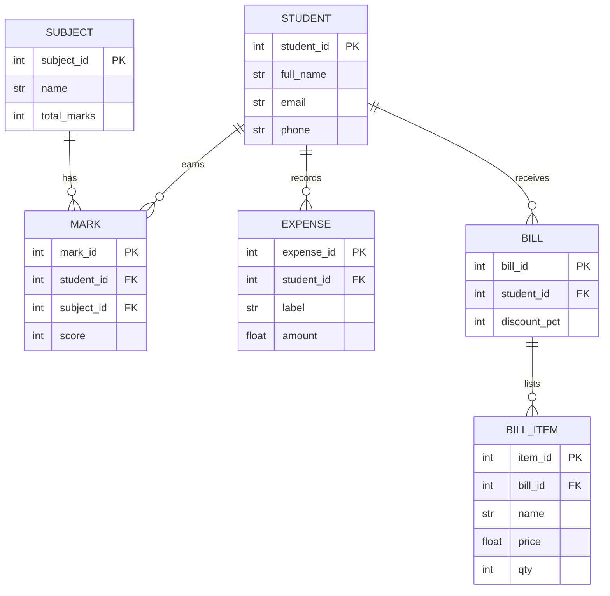

<div align="center">



<br>


### 🔗 [Open the visual preview &rarr;](./preview.html)

<sub>GitHub shows `preview.html` as source code. To see it rendered, enable **GitHub Pages** (Settings &rarr; Pages &rarr; deploy from branch) and open<br>`https://<your-username>.github.io/<repo-name>/preview.html`, or just open the file in your browser after cloning.</sub>

</div>

---

# Python Functions, Strings, Lists & Tuples

## Learning Path



## Repository Structure
```text
python-functions-and-strings/
├── README.md
├── preview.html
├── 01_functions_fundamentals.py
├── 02_strings_lists_tuples.py
└── assets/
    ├── header.svg
    ├── footer.svg
    ├── learning-path.svg
    ├── function-flow.svg
    ├── print-vs-return.svg
    ├── string-slicing.svg
    ├── collections-matrix.svg
    ├── challenges-chart.svg
    └── er-diagram.svg
```

All graphics are animated vector SVGs, so they stay sharp at any resolution, including HD and retina displays.

## Lecture Files

| File | Concepts |
|---|---|
| `01_functions_fundamentals.py` | Function definition and calls, parameters, arguments, defaults, `print()` vs `return`, scope, `*args`, `**kwargs`, validation, reusable function design |
| `02_strings_lists_tuples.py` | Quotes, indexing, slicing, immutability, f-string formatting, string cleaning, `split()` and `join()`, lists, list methods, list comprehension, tuples, unpacking |
| `preview.html` | Visual, animated overview of this lecture. Open it in any browser |

## Requirements
- Python 3.10 or later
- VS Code or another Python editor
- Terminal / Command Prompt
- No third-party packages required

## Key Concepts

### Functions
Functions organize code into reusable blocks. Parameters receive information; `return` sends a result back to the caller.

```python
def calculate_total(price: float, quantity: int) -> float:
    return price * quantity

bill = calculate_total(250, 3)
print(bill)
```



### `print()` vs `return`

| `print()` | `return` |
|---|---|
| Displays information on the screen | Sends a value back to the caller |
| Useful for messages and output | Useful when a result must be stored, reused, or tested |



### Strings

Strings store text. They support indexing and slicing, but are immutable: individual characters cannot be changed in place. Create a new string when modifying text.



### Lists

Lists are ordered, mutable collections. Use methods such as `append()`, `insert()`, `remove()`, and `pop()` to manage items.

### Tuples

Tuples are ordered, immutable collections. They are useful for fixed records and support unpacking into variables.

### Choosing a Data Structure



## Data Model Behind the Challenges

The student, marks, expense and shopping-bill challenges all describe the same small data model. In Python, one tuple inside a list is one row of a table.



<details>
<summary>Same diagram as Mermaid (renders natively on GitHub)</summary>



</details>

## Student Practice Challenges



### Functions

1. Write a function to calculate the area of a rectangle.
2. Calculate a student's percentage out of 1100 marks.
3. Create a shopping-bill function that applies a 10% discount.
4. Accept multiple expense values using `*args`.
5. Create a student profile function using `**kwargs`.

### Strings

1. Ask for a full name and remove unnecessary spaces.
2. Convert an email address to lowercase.
3. Extract the first four characters of a string.
4. Reverse a student's name using slicing.
5. Format a Pakistani phone number as `+92 300 1234567`.

### Lists

1. Create a list of five student names.
2. Add, update, and remove names.
3. Store five examination marks and calculate their average.
4. Display marks greater than or equal to 80.

### Tuples

1. Create a tuple containing student information.
2. Access tuple values using indexing.
3. Unpack a tuple into separate variables.
4. Explain why a tuple cannot be modified.
5. Store multiple student records using tuples inside a list.

## GitHub Submission Instructions

1. Clone this repository.
2. Run both Python files.
3. Review and understand the examples.
4. Complete the practice challenges in your own Python file(s).
5. Push your work to your own GitHub repository.
6. Submit your repository URL for assessment.

## Key Takeaways

- **Functions** make code reusable and organized.
- **Strings** represent and transform textual information.
- **Lists** manage collections that can change.
- **Tuples** store ordered data that should remain fixed.

These fundamentals prepare students for Python OOP, Django, REST APIs, and AI-powered applications.

---


<div align="center">

**PSEB DEPLOY: Python, Django & AI Bootcamp**  
Author: [Maida Javed]

</div>
